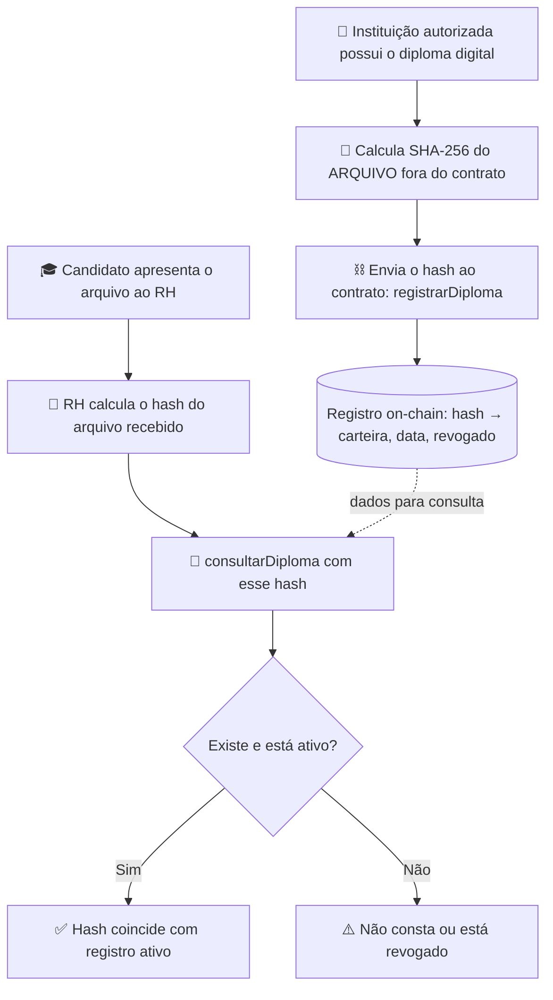

# 🎓 Verificação de Diplomas com Blockchain

> 🧩 **Estudo interativo:** abra [`index.html`](./index.html) no navegador para revisar com flashcards, perguntas e simulação da fala.

[🎤 Minha fala](#-minha-parte-na-apresentação-prioridade-máxima) · [🧠 Visão geral](#-o-projeto-em-30-segundos) · [⛓️ Blockchain](#-como-a-solução-funciona) · [💻 Smart contract](#-entendendo-o-smart-contract-de-verdade) · [🧪 Remix](#-roteiro-para-demonstrar-no-remix-ide) · [❓ Perguntas](#-perguntas-de-professor-e-respostas) · [✅ Checklist](#-checklist-final-para-amanhã)

---

## 🧠 O projeto em 30 segundos

**Problema:** diplomas podem ser falsificados/adulterados; a verificação feita por empregadores costuma depender de procedimentos manuais e contato com instituições de ensino, o que gera demora.

**Contexto:** com ensino a distância, trabalho remoto e contratações entre estados e países, o recrutador pode precisar conferir documentos de uma instituição distante, sem um procedimento único de consulta.

**Proposta:** uma instituição **autorizada** registra na blockchain o **hash** do diploma. Quem possui o arquivo calcula o hash correspondente e consulta se há um registro **existente e ativo**, associado à instituição emissora.

**Limite:** o sistema **não emite** o diploma, **não substitui** o MEC nem os requisitos legais e **não garante por si só** que o curso ou instituição sejam regulares. É uma **camada complementar de verificação**.

> 💡 **Frase para memorizar:** “Nosso projeto não coloca o diploma inteiro na blockchain; ele registra uma prova criptográfica para ajudar a conferir sua integridade e seu status.”

### 🗺️ Onde cada tema aparece nos slides

| Slide | Tema | O que lembrar |
|---|---|---|
| **1** | Abertura | Verificação de Diplomas com Blockchain |
| **2** | **Descrição do problema** 🎤 | Fraudes, processos manuais, exigências legais |
| **3** | **Contexto** 🎤 | Ensino remoto/EAD, contratações geograficamente dispersas, normas do MEC |
| **4** | Stakeholders | IES, alunos, RH, órgãos reguladores/conselhos, ANPD |
| **5** | Dados e LGPD | Dados técnicos *on-chain*, dados pessoais *off-chain* |
| **6** | Justificativa | Integridade, autoria, rastreabilidade e camada complementar |
| **7** | Comparação | Blockchain × banco de dados tradicional |
| **8** | Sem blockchain | Maior centralização e dependência do administrador |
| **9** | Conclusão | Confiança, transparência e privacidade |

> ⚠️ **Observação:** o arquivo de slides apresenta a **Parte A**. A **Parte B (Smart Contract)** está implementada no arquivo `VerificacaoDiplomas.sol`; o grupo pode precisar demonstrá-la diretamente no Remix, conforme a atividade.

---

## 🎤 Minha parte na apresentação — PRIORIDADE MÁXIMA

### 🎯 Slide 2 — Descrição do problema

**Ideias obrigatórias:**

1. 🎓 **Falsificação e adulteração:** um candidato pode apresentar um diploma falso ou modificado.
2. 🕐 **Verificação burocrática:** o RH pode precisar procurar a secretaria da instituição e aguardar uma resposta.
3. 💸 **Custo e lentidão:** isso atrasa seleções e consome tempo de funcionários.
4. 🔒 **Cuidado com a legalidade e a privacidade:** verificar não pode significar expor CPF, histórico acadêmico e outros dados pessoais.

#### 🗣️ Fala sugerida (aproximadamente 50–70 segundos)

> “O problema que escolhemos foi a **dificuldade de verificar a autenticidade de diplomas acadêmicos**. Hoje, existem riscos de falsificação e adulteração desses documentos. Quando uma empresa recebe um diploma em um processo seletivo, nem sempre consegue confirmar rapidamente se ele é verdadeiro. Em alguns casos, é preciso entrar em contato com a instituição de ensino e esperar que a secretaria faça a conferência. Isso pode tornar a contratação **lenta, burocrática e custosa**. Além disso, a verificação precisa respeitar as exigências legais e proteger os dados pessoais dos estudantes. Por isso, nosso grupo propôs usar blockchain para **facilitar a conferência da integridade e do status do registro do diploma**, sem precisar armazenar o documento inteiro em uma rede pública.”

**Exemplo para explicar com naturalidade:** uma empresa recebe o diploma de um candidato formado em outro estado. Antes de concluir a contratação, precisa ter confiança de que o documento não foi adulterado. O contato manual com a instituição pode atrasar essa etapa.

**Transição para o próximo slide:** “Esse problema fica ainda mais relevante quando observamos como o mercado de trabalho e a educação funcionam hoje.”

### 🌍 Slide 3 — Contexto em que o problema ocorre

**Ideias obrigatórias:**

1. 🌐 **Mercado de trabalho conectado:** empresas contratam profissionais de outras cidades, estados e países.
2. 💻 **EAD e trabalho remoto:** aumentam as situações em que o recrutador não conhece diretamente a instituição emissora.
3. 🔍 **Falta de padronização:** conferir credenciais de instituições diferentes pode exigir procedimentos diversos.
4. ⚖️ **MEC e validade jurídica:** a solução precisa complementar — **nunca substituir** — os procedimentos legais de emissão e registro de diplomas.

#### 🗣️ Fala sugerida (aproximadamente 50–70 segundos)

> “Esse problema acontece na relação entre **instituições de ensino e mercado de trabalho**. Com a expansão do **ensino a distância** e das **contratações remotas**, uma empresa pode receber diplomas emitidos em outras cidades, estados ou até países. Para o recrutador, nem sempre existe uma forma única e rápida de verificar se aquele documento não sofreu alterações. No Brasil, também existem normas do **Ministério da Educação** e requisitos para os diplomas digitais, como autenticidade, integridade e validade jurídica. Por isso, nossa ideia não é substituir o processo oficial das faculdades ou o MEC, mas **acrescentar uma ferramenta de verificação**, que facilite a consulta ao registro e reduza a dependência de processos manuais.”

**Transição para os colegas:** “A partir desse cenário, identificamos os participantes envolvidos e quais informações precisariam ser protegidas ou registradas na solução.”

### 🗣️ Versão curta caso falte tempo (25–35 segundos por slide)

<details>
<summary>🕐 Abrir versão curta do slide 2</summary>

“Nosso grupo identificou como problema a falsificação e a adulteração de diplomas, além da dificuldade de verificar sua autenticidade. Hoje, essa conferência pode exigir contato manual com secretarias, causando demora, custos e burocracia para o RH. A proposta é facilitar a verificação com blockchain, mantendo a proteção dos dados pessoais e respeitando os procedimentos legais.”

</details>

<details>
<summary>🕐 Abrir versão curta do slide 3</summary>

“Com o crescimento do EAD e do trabalho remoto, empresas recebem diplomas de instituições localizadas em diferentes regiões. Isso torna a verificação mais desafiadora, principalmente sem um processo padronizado. A blockchain entra como uma camada complementar de segurança; ela não substitui o MEC nem a responsabilidade legal de emissão das instituições.”

</details>

### 🧷 Método para memorizar sua fala: **FRAUDE → DEMORA → DISTÂNCIA → REGRAS → SOLUÇÃO**

- **Fraude:** falsificação ou adulteração de diplomas.
- **Demora:** RH depende de processos manuais.
- **Distância:** contratações entre estados/países e expansão do EAD.
- **Regras:** MEC, validade jurídica e LGPD precisam ser respeitados.
- **Solução:** registro verificável por hash, como camada complementar.

---

## 👥 Parte A — Quem participa? (stakeholders)

*Stakeholders* são as pessoas, organizações e órgãos **envolvidos ou impactados** pelo problema.

| Participante | Papel no projeto |
|---|---|
| 🏫 **Instituições de Ensino Superior (IES)** | Emitem/registram diplomas conforme a legislação; no protótipo, carteiras autorizadas registram hashes. |
| 🎓 **Alunos** | São titulares dos diplomas e apresentam as credenciais. |
| 💼 **Empregadores e RH** | Consultam a autenticidade durante processos seletivos. |
| 🏛️ **MEC e conselhos de classe (como CREA/CRM)** | Exercem funções de regulação/fiscalização em seus respectivos âmbitos; **não** são substituídos pelo contrato. |
| 🔐 **ANPD** | Atua na fiscalização do cumprimento da LGPD e da proteção de dados. |

🧠 **Macete:** “A **faculdade emite**, o **aluno apresenta**, o **RH confere**, os **órgãos regulam** e a **ANPD fiscaliza dados**.”

---

## 🗄️ Parte A — Quais dados são armazenados?

O **documento descritivo e os slides** propõem a seguinte separação:

| ⛓️ *On-chain* (na blockchain) | 🔒 *Off-chain* (fora da blockchain) |
|---|---|
| Hash SHA-256 do arquivo | Arquivo original do diploma |
| Identificador da instituição e do registro | Nome e CPF do estudante |
| Data e hora do registro/emissão, conforme a proposta | Dados do curso e da instituição |
| Status (ativo ou revogado) | Histórico acadêmico |
| Carteira autorizada da instituição emissora | Certificados digitais e informações de assinatura |

**Por quê?** Para publicar **provas técnicas de conferência**, evitando exposição desnecessária de documentos e informações pessoais. O armazenamento externo deve ter controles de acesso e proteção apropriados. Isso é uma **decisão arquitetural descrita no projeto**, não uma implementação completa de conformidade com a LGPD.

> ⚠️ **Diferença entre a proposta e o código de verdade:** o contrato atual não tem campos separados para “ID da instituição” e “ID do diploma”; utiliza o **hash (`bytes32`) como chave do registro** e o **endereço da carteira como instituição emissora**. O campo `dataEmissao` usa `block.timestamp`, isto é, **o momento em que a transação foi registrada no bloco**, que pode ser diferente da data original da emissão acadêmica.

---

## ⛓️ Como a solução funciona

**Hash = impressão digital do arquivo.** Um algoritmo como SHA-256 transforma o conteúdo de um arquivo em uma sequência de 256 bits (representada habitualmente por 64 caracteres hexadecimais). Se o conteúdo mudar, o hash normalmente será diferente.



**Atenção aos limites:** “hash encontrado e ativo” significa que **existe um registro ativo no contrato para aquele conteúdo**, associado a uma carteira emissora. Também é necessário confiar no processo de **autorização das instituições** e verificar os requisitos legais. O contrato **não analisa** a validade acadêmica real de um curso, não consulta bases do MEC e não examina o arquivo original.

### 🧩 Termos que você deve conseguir explicar

<details>
<summary>⛓️ Blockchain</summary>

Registro compartilhado e protegido por mecanismos criptográficos e, conforme a rede, de consenso. Ajuda a tornar alterações retroativas difíceis e permite verificar registros sem depender exclusivamente de um servidor administrado por uma única entidade.

</details>

<details>
<summary>🔐 Hash e SHA-256</summary>

**Hash** é o resultado de uma função criptográfica aplicada aos dados. **SHA-256** é um algoritmo que produz um hash de 256 bits. O hash é útil para conferir integridade: dois arquivos idênticos têm o mesmo hash SHA-256. **Não é criptografia reversível** e não permite recuperar o diploma a partir do resultado.

</details>

<details>
<summary>📜 Smart contract / Solidity / Remix</summary>

**Smart contract:** código executado na blockchain, com regras automáticas. **Solidity:** linguagem em que o grupo escreveu o contrato. **Remix IDE:** ambiente para compilar, implantar e testar esse código, por exemplo usando a máquina virtual do Remix.

</details>

<details>
<summary>👛 Wallet, msg.sender e block.timestamp</summary>

**Wallet/carteira:** endereço associado às transações. **`msg.sender`:** endereço de quem executa a chamada atual. **`block.timestamp`:** carimbo temporal do bloco que inclui a transação; no contrato ele é armazenado em `dataEmissao`.

</details>

<details>
<summary>👁️ On-chain × off-chain e LGPD</summary>

**On-chain:** dados gravados na blockchain. **Off-chain:** dados mantidos fora dela. No projeto, documento completo e dados pessoais ficam fora da rede; registros técnicos ficam nela. Isso ajuda a **reduzir** exposição, mas não significa conformidade jurídica automática com a LGPD.

</details>

---

## 🆚 Blockchain ou banco de dados tradicional?

| Critério | Banco tradicional | Blockchain (na proposta) |
|---|---|---|
| **Administração** | Normalmente centralizada na organização responsável | Registros podem ser compartilhados e verificados em rede |
| **Confiança** | Requer confiança no operador, nas permissões e nas auditorias | Pode apoiar verificação independente e rastreabilidade |
| **Alterações** | Um administrador autorizado pode alterar registros; mecanismos de auditoria são possíveis | Registros históricos tendem a ser mais resistentes a alterações retroativas |
| **Consulta** | Depende de API/sistema e das permissões do administrador | Pode permitir consulta direta aos registros disponibilizados na rede |
| **Privacidade** | Controles convencionais de acesso e exclusão são possíveis | Requer cuidado extra com o que é gravado de forma duradoura |

**Resposta à professora: por que blockchain?** Porque a proposta busca uma **evidência compartilhável, auditável e verificável** por diferentes participantes, reduzindo a dependência exclusiva de uma instituição ou servidor.

**E sem blockchain?** A solução **continuaria tecnicamente possível**, mas dependeria mais de quem administra o banco, dos servidores e das permissões de acesso; o **modelo de confiança e governança** mudaria.

> 🧠 Não diga: “banco tradicional não é seguro” ou “um banco nunca pode ser auditado”. Isso não é verdade. O argumento do projeto é **distribuição da confiança e facilidade de verificação independente**, não impossibilidade técnica de uma solução centralizada.

---

## 💻 Parte B — Entendendo o Smart Contract de verdade

**Arquivo analisado:** [`VerificacaoDiplomas.sol`](./VerificacaoDiplomas.sol). Linguagem: **Solidity**, com `pragma solidity ^0.8.20`.

### 📦 Variáveis e estrutura

| Elemento no código | Tipo | Para que serve |
|---|---|---|
| `administrador` | `address` | Carteira que fez o deploy do contrato (definida no `constructor`). |
| `instituicoesAutorizadas` | `mapping(address => bool)` | Diz se cada carteira está autorizada a registrar diplomas. |
| `Diploma.instituicaoEmissora` | `address` | Carteira que registrou o hash. |
| `Diploma.dataEmissao` | `uint256` | `block.timestamp` do registro. |
| `Diploma.revogado` | `bool` | Indica se o diploma foi revogado. |
| `Diploma.existe` | `bool` | Indica se aquele hash já foi registrado. |
| `diplomas` | `mapping(bytes32 => Diploma)` | Busca um diploma pelo hash. |

**`bytes32`** = dado de 32 bytes / 256 bits. O contrato recebe o hash pronto; **não** calcula SHA-256 nem lê o arquivo PDF.

### 🛠️ Funções, permissões e resultados

| Função | Quem pode chamar? | O que faz? | Regras importantes |
|---|---|---|---|
| `constructor()` | Quem implanta o contrato | Define `administrador = msg.sender` | Executado na implantação. |
| `cadastrarInstituicao(address)` | 👑 **Só administrador** | Autoriza uma carteira | Não aceita endereço zero ou já cadastrado. |
| `registrarDiploma(bytes32)` | 🏫 **Só instituição autorizada** | Cria registro ativo com hash, carteira e data | Rejeita hash zero e hash já registrado. |
| `consultarDiploma(bytes32)` | 👀 **Qualquer pessoa** | Consulta existência, atividade, instituição e timestamp | É `view`: não altera o estado. |
| `revogarDiploma(bytes32)` | 👑 **Administrador** OU 🏫 **instituição que registrou** | Altera `revogado` para `true` | Precisa existir e não estar revogado. |

**Eventos** (registros de acontecimentos de transações):

- `InstituicaoCadastrada` — uma carteira foi autorizada.
- `DiplomaRegistrado` — um hash foi registrado por uma instituição.
- `DiplomaRevogado` — um hash teve seu status revogado.

**O que a consulta devolve?** `existe`, `ativo`, `instituicao`, `dataEmissao`. A lógica central é `ativo = existe && !revogado`.

| Situação | `existe` | `ativo` |
|---|---:|---:|
| Nunca registrado | `false` | `false` |
| Registrado e não revogado | `true` | `true` |
| Registrado e revogado | `true` | `false` |

### 🔐 Regras de negócio mais importantes

1. Só o administrador cadastra instituições; isso é verificado pelo **modifier** `apenasAdministrador`.
2. Só carteiras autorizadas registram diplomas.
3. Cada hash pode ser registrado **uma única vez**, inclusive após revogação.
4. A consulta é pública e não modifica os dados.
5. O administrador ou a carteira que emitiu podem revogar, mas não há função para desfazer uma revogação.

### ⚠️ Proposta do PDF versus implementação Solidity

| O projeto descreve… | O código efetivamente implementa… |
|---|---|
| “Hash SHA-256 do documento” | Recebe um `bytes32`; não produz nem verifica o SHA-256 do arquivo. |
| “Identificador único do diploma” | Usa o próprio hash como **chave** de busca; não há campo separado de ID. |
| “Identificador da instituição” | Registra o **endereço da carteira** emissora, não um nome/ID institucional oficial. |
| “Data e hora da emissão” | Salva o horário de **registro no bloco** como `dataEmissao`. |
| “Dados pessoais protegidos fora da blockchain” | Não grava nome/CPF; **não** implementa armazenamento, autenticação ou criptografia off-chain. |
| “Emissão e validade conforme MEC/LGPD” | Não realiza validações jurídicas ou integrações com MEC/ANPD. |
| “Consulta de diploma” | Consulta existência, status, endereço emissor e timestamp. |

**Como explicar essa diferença?** “O PDF apresenta a arquitetura pretendida. O Smart Contract é o **protótipo mínimo funcional dessa ideia**, focado no controle de instituições, registro do hash, consulta e revogação. A validação documental externa e os demais componentes seriam outras partes do sistema.”

---

## 🧪 Roteiro para demonstrar no Remix IDE

> Ambiente: [remix.ethereum.org](https://remix.ethereum.org/). Os passos abaixo são um **roteiro de teste**, não um registro de que o grupo já compilou ou implantou o contrato com sucesso.

1. **Criar/abrir** `VerificacaoDiplomas.sol`, usando compilador Solidity compatível com `^0.8.20`.
2. **Compilar**, abrir **Deploy & Run Transactions**, selecionar **Remix VM** e escolher a **Conta A**.
3. **Deploy** do contrato pela Conta A → ela será o **administrador**.
4. Trocar para **Conta A** e executar `cadastrarInstituicao(ENDERECO_DA_CONTA_B)` → Conta B autorizada.
5. Trocar para **Conta B**, executar `registrarDiploma(HASH_DE_TESTE)`.
6. Em qualquer conta, chamar `consultarDiploma(HASH_DE_TESTE)` → esperado: `existe = true`, `ativo = true`, endereço da Conta B e timestamp numérico.
7. Trocar para **Conta C** (não autorizada). Tentar `registrarDiploma(OUTRO_HASH)` → **falha**. Tentar revogar o hash registrado → **falha**.
8. Trocar para **Conta A ou B**, executar `revogarDiploma(HASH_DE_TESTE)` → registro revogado.
9. Consultar o hash de novo → `existe = true`, mas `ativo = false`.

**Hash ilustrativo para testar** (SHA-256 do **texto de teste** `DIPLOMA_DE_TESTE_2026`, **não** de um diploma real):

```text
0x7e8396fd0cb31dbcac582600b0916770b8c1fe8165f2b859b7f2c6385f90f434
```

**Como seria no uso real?** O SHA-256 deve ser calculado sobre os **bytes exatos do arquivo** do diploma, fora do contrato, e tanto a instituição como o verificador precisam usar o **mesmo arquivo**. Não basta escrever qualquer string e dizer que é o hash do diploma.

<details>
<summary>🐞 Erros comuns e como entender</summary>

- **`Apenas administrador`** → a carteira selecionada não é a que implantou o contrato.
- **`Instituicao nao autorizada`** → a carteira que tenta registrar não foi cadastrada pelo administrador.
- **`Endereco invalido`** → foi informado `address(0)`.
- **`Hash invalido`** → foi informado `bytes32(0)`.
- **`Diploma ja registrado`** → aquele hash já existe no mapeamento.
- **`Diploma nao encontrado`** → ninguém registrou aquele hash.
- **`Sem permissao para revogar`** → a carteira não é o administrador nem a emissora daquele registro.
- **`Diploma ja revogado`** → segunda tentativa de revogar o mesmo hash.

</details>

---

## ❓ Perguntas de professor e respostas

Tente responder **em voz alta** antes de abrir.

<details><summary>1. Qual é exatamente o problema que vocês querem resolver?</summary>

A falsificação/adulteração de diplomas e a conferência lenta, manual e burocrática de sua autenticidade por recrutadores, mantendo proteção de dados e respeito às exigências legais.
</details>

<details><summary>2. Onde esse problema acontece?</summary>

Na relação entre instituições de ensino, alunos e mercado de trabalho, especialmente com educação a distância, trabalho remoto e contratações entre estados/países.
</details>

<details><summary>3. Por que blockchain e não um banco de dados comum?</summary>

Pela possibilidade de manter evidências verificáveis por diferentes participantes, com maior rastreabilidade e menor dependência de um único administrador. Um banco tradicional também poderia resolver, mas teria outro modelo de confiança e governança.
</details>

<details><summary>4. Vocês armazenam o diploma completo na blockchain?</summary>

Não. A arquitetura propõe registrar apenas dados técnicos, principalmente o hash, além de carteira emissora, status e timestamp. Arquivo e dados pessoais ficam fora da rede.
</details>

<details><summary>5. O que é SHA-256? O contrato calcula esse hash?</summary>

SHA-256 é uma função hash criptográfica de 256 bits. **O contrato não o calcula:** recebe um `bytes32` pronto. No projeto completo, o SHA-256 é gerado a partir do arquivo fora do contrato.
</details>

<details><summary>6. O que acontece se o diploma for adulterado?</summary>

Ao recalcular o SHA-256 do arquivo alterado, em geral o resultado será diferente do hash do arquivo original registrado; a busca por esse novo hash não encontrará o registro original. Isso detecta divergência do conteúdo, mas não substitui verificar quem autorizou o registro.
</details>

<details><summary>7. Quem pode registrar diplomas?</summary>

Apenas o endereço de uma instituição previamente autorizado pelo administrador do contrato.
</details>

<details><summary>8. Quem pode revogar um diploma?</summary>

O administrador ou a carteira da instituição que registrou aquele hash, desde que o diploma exista e ainda não tenha sido revogado.
</details>

<details><summary>9. Qualquer pessoa pode consultar?</summary>

Sim. `consultarDiploma` é pública e `view`. Retorna existência, status ativo, carteira emissora e timestamp.
</details>

<details><summary>10. Qual é a diferença entre `existe` e `ativo`?</summary>

`existe` indica se o hash já foi registrado. `ativo` só é verdadeiro se o registro existir **e não estiver revogado**. Revogar não apaga o registro.
</details>

<details><summary>11. A blockchain garante que o diploma é legal e reconhecido pelo MEC?</summary>

Não. O registro comprova a existência de uma evidência associada à carteira cadastrada; a regularidade da instituição, do curso e a validade jurídica continuam sujeitas aos procedimentos legais competentes.
</details>

<details><summary>12. Como a LGPD entra na proposta?</summary>

A proposta separa evidências técnicas on-chain de informações pessoais/documentos off-chain. Isso reduz exposição, mas é preciso implementar segurança, governança e demais obrigações legais no sistema completo.
</details>

<details><summary>13. Se um hash foi revogado, é possível registrá-lo novamente?</summary>

Não neste contrato. `diplomas[_hash].existe` continua `true` após a revogação, e `registrarDiploma` rejeita hashes já registrados.
</details>

<details><summary>14. O que é `msg.sender` e para que serve?</summary>

É o endereço do chamador da transação. O contrato o usa para identificar o administrador, checar autorização para registro e validar quem pode revogar.
</details>

<details><summary>15. Qual a limitação mais importante do protótipo?</summary>

Ele implementa o **registro/consulta/revogação** de hashes por carteiras autorizadas, mas não calcula o hash do arquivo, não valida juridicamente instituições/diplomas e não implementa o armazenamento off-chain. Por isso é um protótipo e não uma solução completa pronta para produção.
</details>

---

## ✅ Checklist final para amanhã

- [ ] Consigo explicar o problema **sem ler o slide**.
- [ ] Sei dar um **exemplo de RH verificando diploma de outro estado**.
- [ ] Consigo relacionar o contexto a **EAD, trabalho remoto e diferentes instituições**.
- [ ] Sei dizer que **MEC, emissão legal e LGPD não são substituídos pela blockchain**.
- [ ] Sei a diferença entre **hash, diploma digital, blockchain e smart contract**.
- [ ] Consigo listar os **stakeholders**.
- [ ] Sei diferenciar **on-chain** de **off-chain**.
- [ ] Sei justificar por que blockchain, **sem dizer que banco tradicional é inseguro**.
- [ ] Sei explicar as **quatro funções principais** do contrato.
- [ ] Sei **quem registra e quem revoga**.
- [ ] Lembro que `dataEmissao` é, na prática, **o timestamp da transação**.
- [ ] Lembro que o contrato **não calcula SHA-256**.
- [ ] Consigo fazer o fluxo básico de teste no **Remix**.

### ⏱️ Plano prático de revisão (aproximadamente 25 minutos)

1. **5 min:** memorize as cinco palavras **Fraude → Demora → Distância → Regras → Solução**.
2. **7 min:** ensaie a fala dos **slides 2 e 3** em voz alta sem ler.
3. **5 min:** percorra stakeholders, dados e comparação com banco tradicional.
4. **5 min:** entenda as funções e permissões Solidity.
5. **3 min:** faça o quiz do [`index.html`](./index.html) e retome os erros.

---

## 📚 Materiais que embasaram este guia

1. **`Blockchain- Fase 1.pdf`** — descrição, contexto, stakeholders, arquitetura de dados, justificativa e comparação com banco de dados tradicional (7 páginas).
2. **`VerificacaoDiplomas.sol`** — código do contrato, variáveis, regras, permissões, eventos e consultas.
3. **`Verificacao_Diplomas_Blockchain_apresentacao_melhorada (1).pptx`** — apresentação de 9 slides; o foco da sua fala está nos slides 2–3.

**Critério de leitura:** quando o **PDF ou os slides descrevem uma arquitetura** mas o **contrato implementa apenas parte dela**, o guia identifica essa diferença explicitamente. Exemplos de falas e cenário de recrutamento são **ilustrações didáticas**, não resultados de testes. Nenhuma implantação real, homologação legal ou conformidade com a LGPD foi comprovada pelos arquivos.
